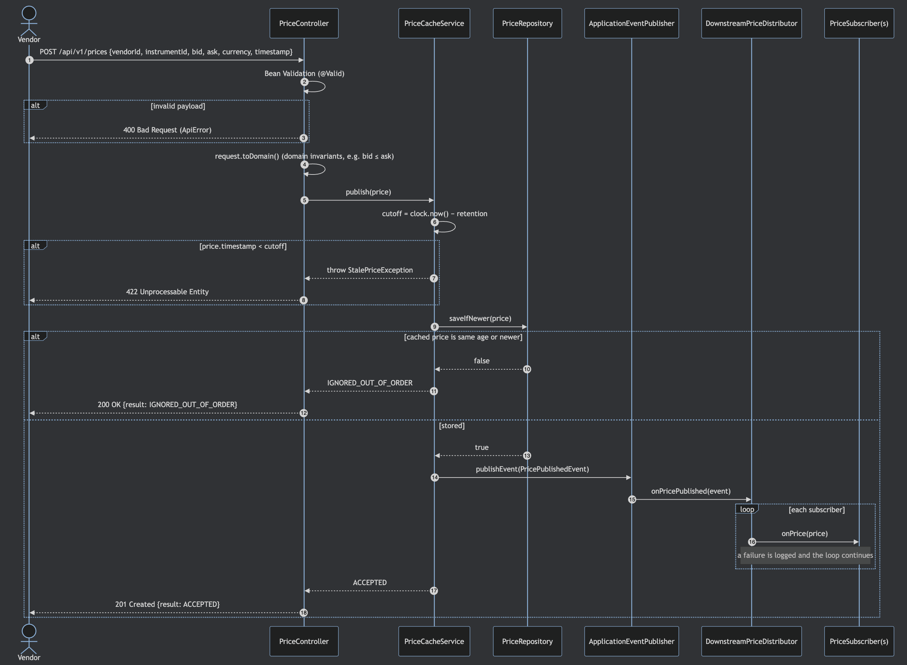
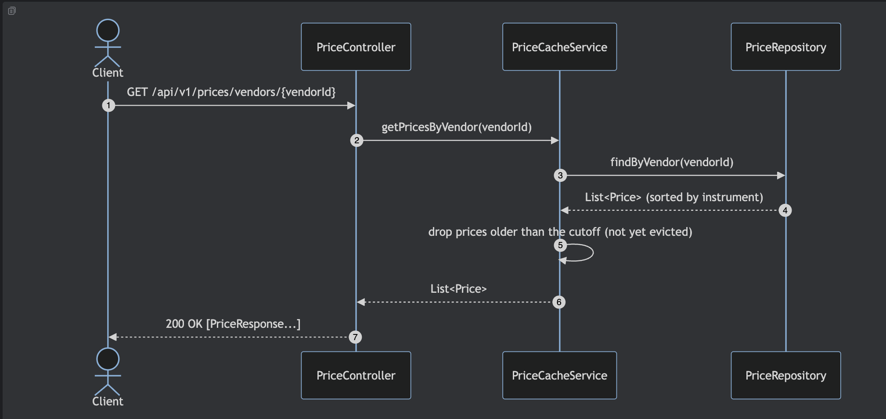
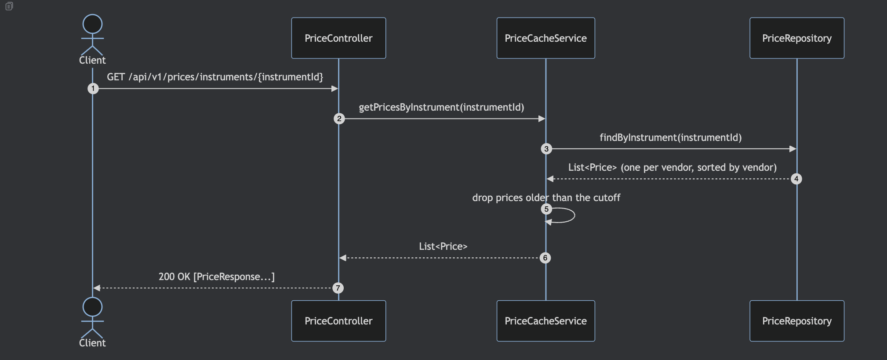
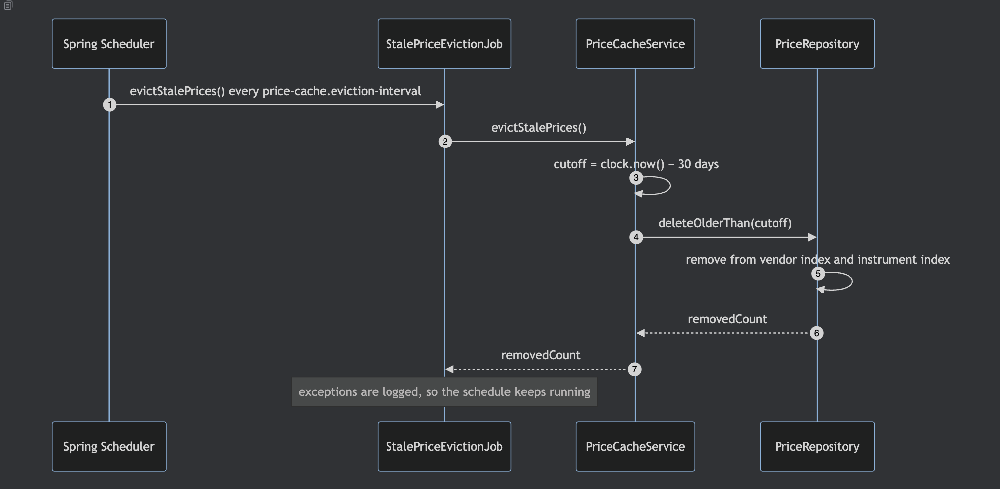
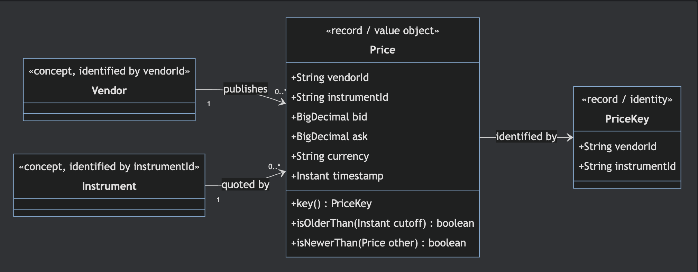

# Price Cache Service: Design

## 1. Problem summary

| Requirement | How it is met |
|---|---|
| Many vendors publish prices; one instrument has different prices per vendor | Prices are keyed by **(vendor, instrument)**; each vendor's quote is kept separately |
| Cache prices locally | `PriceRepository` port with an `InMemoryPriceRepository` adapter |
| Distribute to downstream systems | Every stored price raises a `PricePublishedEvent`; `DownstreamPriceDistributor` fans it out to all `PriceSubscriber` beans |
| Clients publish and retrieve | REST API: `POST /api/v1/prices`, `GET /api/v1/prices/vendors/{vendorId}`, `GET /api/v1/prices/instruments/{instrumentId}` |
| All prices from a vendor / one instrument across vendors | Two indexes (vendor→instrument→price and instrument→vendor→price) so each query is a single lookup |
| Remove prices older than 30 days | Scheduled `StalePriceEvictionJob`, plus rejection on publish and filtering on read. Retention is configurable (`price-cache.retention`) |

## 2. Architecture

```mermaid
flowchart LR
    V[Vendors] -- POST /api/v1/prices --> C[PriceController]
    CL[Client systems] -- GET by vendor / instrument --> C
    C --> S[PriceCacheService]
    S --> R[(PriceRepository<br/>InMemoryPriceRepository)]
    S -- PricePublishedEvent --> D[DownstreamPriceDistributor]
    D --> S1[LoggingPriceSubscriber]
    D --> S2[Other PriceSubscriber<br/>e.g. Kafka / JMS / WebSocket]
    J[StalePriceEvictionJob<br/>@Scheduled] --> S
```

The layers are:

| Package | Responsibility |
|---|---|
| `web` | HTTP contract: request/response DTOs, validation, error mapping |
| `service` | Business rules: retention, out-of-order handling, raising events |
| `domain` | Immutable value objects with their own invariants |
| `repository` | Persistence port and the in-memory adapter |
| `distribution` | Fan-out to downstream systems |
| `scheduling` | Periodic eviction |
| `config` | Externalised properties, `Clock` bean |
| `demo` | Optional sample-data loader (`demo` profile) |

## 3. Sequence diagrams

### 3.1 Vendor publishes a price



### 3.2 Client retrieves all prices from a vendor



### 3.3 Client retrieves one instrument's prices from every vendor



### 3.4 Scheduled eviction of stale prices


### 3.5 Choices made

| Decision | Alternatives considered | Why |
|---|---|---|
| Keep the **latest price per (vendor, instrument)** | Keep a full time series | The cache serves current prices to downstream systems. A series would grow without bound inside the 30-day window and neither query needs history. The repository port could add a history store later. |
| **Last-write-wins by vendor timestamp**, not arrival order | Overwrite on arrival | Vendor feeds can deliver out of order (retries, multiple gateways). Comparing timestamps stops a delayed message from overwriting a newer price. Duplicates (same timestamp) are ignored, so retries are idempotent. |
| **Three-layer retention**: reject on publish, filter on read, scheduled purge | Scheduled purge only | A purge alone would let clients see a 30-day-and-5-minute-old price between runs. Filtering on read makes the 30-day rule exact for clients. The purge only reclaims memory, so it can run infrequently. |
| **Spring application events** between the service and distribution | Service calls the subscribers directly | The service does not know who consumes prices. New downstream transports are added as `PriceSubscriber` beans without touching the service. |
| **Synchronous** event delivery | `@Async` listeners | Delivery stays in publish order for each key and the code is easy to test. An async transport (Kafka etc.) can be its own subscriber. See §6. |
| **REST** for publish and retrieve | Messaging only | Simple to demo and test. Ingestion from a message bus would be another adapter calling the same `PriceCacheService.publish`. |
| `201` accepted, `200` ignored, `422` stale, `400` invalid | One status for everything | Vendors can tell "stored" from "ignored as old" without parsing the body. |

## 4. Domain model (persisted objects)


## 5. Implementation and design patterns

| Pattern | Where | Purpose |
|---|---|---|
| **Repository (Ports and Adapters)** | `PriceRepository` ← `InMemoryPriceRepository` | Hides storage. The service depends only on the interface. |
| **Dependency Injection / Inversion of Control** | Constructor injection everywhere | Wiring is replaceable and every class can be unit tested in isolation. |
| **Value Object / Immutable object** | `Price`, `PriceKey` (Java records) | Thread-safe sharing between the indexes and threads. Validation lives in one place. |
| **Observer / Publish-Subscribe** | `PricePublishedEvent` → `DownstreamPriceDistributor` → `PriceSubscriber`s | Decouples caching from distribution. Downstream systems can be added freely. |
| **Strategy** | `PriceSubscriber` implementations | Each downstream transport is a pluggable strategy. |
| **Facade / Service layer** | `PriceCacheService` | One entry point that owns the business rules for publish, query and evict. |
| **DTO** | `PublishPriceRequest`, `PriceResponse`, `PublishPriceResponse`, `ApiError` | The API contract can change independently of the domain. |
| **Lock-free concurrent maps with atomic newer-wins merge** | `InMemoryPriceRepository` (`ConcurrentHashMap.compute`, conditional `remove(key, value)`) | Reads, writes and eviction never block each other. Each index converges on the newest price. |
| **Scheduler** | `StalePriceEvictionJob` with `@Scheduled` | Periodic housekeeping off the request path. |
| **Controller Advice (centralised error handling)** | `GlobalExceptionHandler` | Consistent error bodies and status codes. |
| **Injectable Clock** | `ClockConfig` | Time-based rules are tested with `Clock.fixed`. |
| **Externalised configuration** | `PriceCacheProperties` (`price-cache.retention`, `price-cache.eviction-interval`) | Retention changes without a code change. |

### Swapping the persistence implementation

The in-memory adapter is the only `PriceRepository` bean. To move to a database:

1. Add `spring-boot-starter-data-jpa` and a driver.
2. Create a `PriceEntity` (`@Entity`, composite id `(vendorId, instrumentId)`, `@Version` optional) and a Spring Data interface.
3. Implement `JpaPriceRepository implements PriceRepository`:
   - `saveIfNewer`: `INSERT … ON CONFLICT (vendor_id, instrument_id) DO UPDATE … WHERE price.price_timestamp < EXCLUDED.price_timestamp` (an atomic conditional upsert). The returned row count gives the boolean.
   - `findByVendor` / `findByInstrument`: derived queries with `ORDER BY`.
   - `deleteOlderThan`: `DELETE FROM price WHERE price_timestamp < :cutoff`.
4. Pick the adapter with `@Profile("jpa")` or `@ConditionalOnProperty(name="price-cache.store", havingValue="jpa")` on both adapters.
5. Run the shared repository behaviour tests against the new adapter (see §7).

No changes are needed in the service, controller, scheduler or distribution code.

### Logging

SLF4J/Logback through Spring Boot. Application packages log at `DEBUG` by default (`application.yml`).
- `INFO`: price cached, out-of-order ignored, eviction counts, downstream delivery (logging subscriber), subscriber count at startup.
- `WARN`: rejected stale or invalid prices.
- `ERROR`: subscriber failures and eviction failures, with stack traces.
- `DEBUG`: per-request tracing in the controller and repository.

## 6. Problems encountered and how they were overcome

| Problem | Resolution |
|---|---|
| **Out-of-order and duplicate vendor messages** could overwrite a newer price with an older one. | `saveIfNewer` compares vendor timestamps inside an atomic `ConcurrentHashMap.compute` and ignores anything that is not strictly newer. The API returns `IGNORED_OUT_OF_ORDER` so vendors can see it happened. |
| **Keeping two indexes consistent under concurrency.** The first version guarded two `HashMap`s with a `ReentrantReadWriteLock`. That was correct, but eviction held the write lock for a full scan and blocked every read and publish while it ran. | Replaced with two `ConcurrentHashMap` indexes and no locks. Each index is updated with the same atomic newer-wins merge, so both end on the newest price whatever order updates arrive in. For a few microseconds one index can be ahead of the other, which is acceptable because every query reads a single index. Eviction removes a price only if it is still the cached one (`remove(key, value)`), so a fresh price arriving mid-eviction is kept. Tests cover 1,000 concurrent updates to one key, and eviction racing with 500 fresh publishes. |
| **Dropping empty inner maps could lose a concurrent write.** A writer could put into an inner map just as eviction removed that map from the outer index. | Inner updates and empty-map removal both run inside `compute` on the outer key. `ConcurrentHashMap` serialises those for the same key, so they can't interleave. |
| **The 30-day rule is not exact if it is enforced only by a periodic job.** | The rule is enforced in three places: reject on publish (`422`), filter on read, and purge on a schedule. Clients never see expired data, whatever the job interval. |
| **Time-dependent logic is hard to test.** | `Clock` is a bean. Unit tests inject `Clock.fixed(...)` and assert exact boundary behaviour (a price exactly at the cutoff is kept; one millisecond earlier is rejected). |
| **A failing downstream system could block publishing or starve other subscribers.** | The distributor catches and logs exceptions per subscriber, and a test covers it. The eviction job also catches exceptions so the schedule keeps running. |
| **Validation split between HTTP and domain.** Bean Validation cannot express "bid ≤ ask" cleanly, and the domain must be valid whatever the entry point. | Field rules (required, positive, currency format) live on the request DTO and produce field-level `400` messages. Cross-field invariants live in the `Price` constructor, and `IllegalArgumentException` maps to `400`. |
| **Cucumber scenarios share a single Spring context**, so state leaked between scenarios. | A `@Before` hook clears the cache (`deleteOlderThan(Instant.MAX)`) and the recording subscriber. No test-only method is added to the production interface. |
| **Testing eviction end to end**: the API refuses stale prices, so they cannot be created through it. | The acceptance step writes an aged price directly through the repository to simulate a price that grew old in the cache, then runs the job. |
| **Synchronous vs asynchronous distribution.** `@Async` would decouple latency but could reorder updates for the same instrument. | Delivery is synchronous to keep ordering. Slow transports should be implemented as subscribers that hand off to their own queue (e.g. a Kafka producer). |

## 7. Testing approach

Tests were written first, then the code to make them pass (red, green, refactor), in **BDD style**:

- **Unit and slice tests** (JUnit 5 + AssertJ + BDDMockito). `@Nested` classes named *Given…*, with methods whose `@DisplayName` reads *when…, then…*. Mocks are set up with `given(...).willReturn(...)` and checked with `then(mock).should()...`.
- **Acceptance tests** (Cucumber + Spring Boot + MockMvc). Gherkin scenarios in `src/test/resources/features/price_cache.feature` run against the full application, including downstream distribution through a recording subscriber.

| Class under test | Test |
|---|---|
| `Price`, `PriceKey` | `PriceTest`, `PriceKeyTest` |
| `InMemoryPriceRepository` | `InMemoryPriceRepositoryTest` (including concurrency) |
| `PriceCacheService`, `StalePriceException`, `PublishResult`, `PricePublishedEvent` | `PriceCacheServiceTest` |
| `StalePriceEvictionJob` | `StalePriceEvictionJobTest` |
| `DownstreamPriceDistributor` | `DownstreamPriceDistributorTest` |
| `LoggingPriceSubscriber` | `LoggingPriceSubscriberTest` (captured log output) |
| `PriceController`, `PublishPriceResponse`, `ApiError` | `PriceControllerTest` (`@WebMvcTest`) |
| `GlobalExceptionHandler` | `GlobalExceptionHandlerTest` + `PriceControllerTest` |
| `PublishPriceRequest` | `PublishPriceRequestTest` (Bean Validation) |
| `PriceResponse` | `PriceResponseTest` |
| `PriceCacheProperties`, `ClockConfig` | `PriceCachePropertiesTest`, `ClockConfigTest` |
| `DemoDataLoader` | `DemoDataLoaderTest` |
| `PriceCacheApplication` (wiring) | `PriceCacheApplicationTest` (`@SpringBootTest`) |
| End-to-end behaviour | `CucumberAcceptanceTest` → `price_cache.feature` |

When a database adapter is added, move the scenarios in `InMemoryPriceRepositoryTest` into an abstract `PriceRepositoryContractTest`. Both adapters then extend it, which guarantees they behave the same.

## 8. Possible extensions

- Reject prices timestamped too far in the future (clock-skew tolerance).
- Batch publish endpoint (`POST /api/v1/prices/batch`) for vendor snapshots.
- Streaming subscription for clients (Server-Sent Events / WebSocket) as another `PriceSubscriber`.
- OpenAPI/Swagger UI via springdoc.
- Metrics (Micrometer counters for accepted, ignored, rejected and evicted prices).
